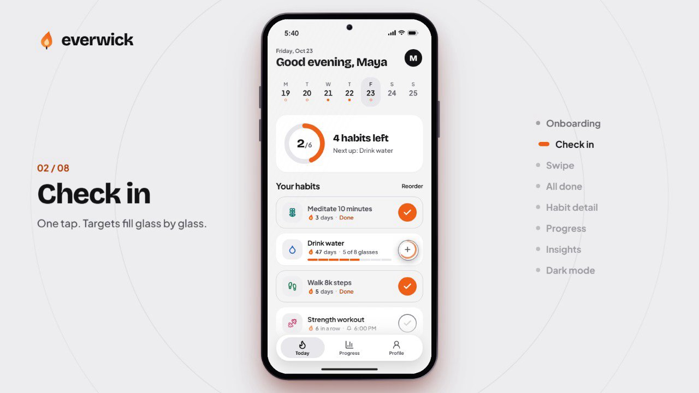
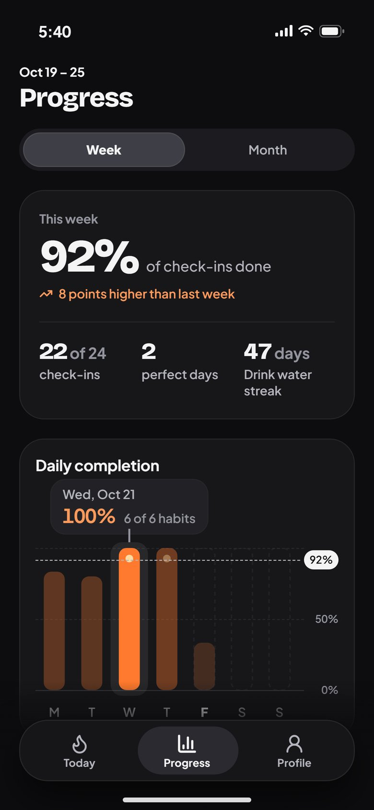

# Everwick

A habit and fitness tracker for iOS and Android, built with React Native and Expo. The same code also runs on the web.

**Concept project.** The Everwick brand is fictional. This is a portfolio piece, not a real product: there is no
backend, no account and no real payment. Everything is stored on the device.

- **Try it:** [everwick-app.vercel.app](https://everwick-app.vercel.app) (the web build; on a wide screen the app is
  shown as a phone-width column)
- **Write-up:** [michaelshadpour.com/work/everwick](https://michaelshadpour.com/work/everwick)





"Small habits. Steady flame." Every day you keep a habit is a small light, and a streak is the flame you keep lit.

## Features

- **Today:** greeting and date, a week strip with a mark under each day, the day's progress ring with what's still
  open, tap-to-check-in with a bounce and spark burst, **swipe right to check in, swipe left to skip**, **hold and drag
  to reorder** (plus a Reorder mode and keyboard shortcuts), streak flames with **streak freezes**, quick add, Undo on
  every check-in and skip, and an all-done celebration: the flame springs up and confetti bursts from the card, with a
  success haptic.
- **Progress:** Week and Month toggle with animated charts, a completion bar chart you can scrub, a 3-month heatmap with
  tap-for-details, best-streak cards and insight cards from an insights engine that has its own unit tests.
- **Habit detail and Add/Edit:** icon, color, schedule, target, reminder, its own streak, freezes, calendar and notes.
- **Profile and settings:** stats, achievements with unlock animations, paused habits (resume any time), dark mode,
  notification settings (local reminders on the phone), export and import as JSON (validated), reset demo data, and a
  mocked Pro screen that is clearly a demo with no purchase.
- **Onboarding:** three short steps (welcome, goals, reminder times) with progress dots and Skip.
- Designed empty, loading and error states; light and dark themes designed separately; haptics on native.
- 60 days of realistic, deterministic demo history for 6 habits.

## Stack

Expo SDK 58, React Native 0.88, Expo Router (typed routes), TypeScript strict, Reanimated 4, Gesture Handler 3,
react-native-svg (custom charts), expo-notifications, expo-haptics, AsyncStorage, zod, lucide icons, Bricolage
Grotesque and Plus Jakarta Sans. Tests with vitest and Playwright. See [ARCHITECTURE.md](ARCHITECTURE.md) and
[DESIGN.md](DESIGN.md).

## Run it

```bash
npm ci                 # install the exact versions from package-lock.json
npx expo start         # on a phone: scan the QR code with Expo Go, or press i / a for a simulator
npm run dev            # Expo dev server for the web build (port 8081, or pass -- --port 3300)
npm run build          # static web build in dist/
npm run start          # serve dist/ on http://127.0.0.1:3310
```

Use Node 22 (22.13 or newer) or Node 24 (24.3 or newer): Expo SDK 58 and React Native 0.88 ask for one of these, and
CI uses Node 22. The `dev`, `web`, `build` and `export:native` scripts set `EXPO_OFFLINE=1` in front of the command,
which is POSIX shell syntax. On Windows, run them in WSL or point npm's `script-shell` setting at a POSIX shell such as
Git Bash.

Checks: `npm run typecheck`, `npm test` (unit tests), `npm run build && npm run e2e` (Playwright on the web build),
`npm run qa` (needs the preview from `npm run start`), `npm run export:native` and `npm run doctor`. The two
Playwright scripts (`e2e` and `qa`) need a browser once: `npx playwright install chromium`.

The unit tests are 400 test cases in 22 files under `tests/`; `tests/e2e/flow.spec.ts` holds 6 end-to-end tests.
CI (`.github/workflows/ci.yml`) runs the type check, the unit tests and the web build on pushes to `main` and on pull
requests.

| Script | What it does |
|---|---|
| `dev` / `web` | Expo dev server (web) |
| `ios` / `android` | Expo dev server targeting a simulator or device |
| `build` / `start` | Web production build / serve it as an SPA |
| `typecheck` | `tsc --noEmit` |
| `test` / `test:watch` | vitest unit tests, once or in watch mode |
| `e2e` | Playwright end-to-end tests on the web build (onboarding to dark mode, data tools, paused habits, gestures and keyboard, Add/Edit habit, habit detail) |
| `qa` | QA sweep (routes x widths x themes: overflow, console errors, axe), plus an in-app navigation pass with focus checks and a Tab walk, and the all-done confetti at phone width |
| `export:native` | Bundle the iOS and Android JavaScript into `.qa/` (a check that the app bundles for both platforms) |
| `doctor` | expo-doctor |
| `icons` | Regenerate the app icon, adaptive icon, splash and favicon from the logo |
| `illustrations` | Regenerate the illustration asset map after adding PNGs |

## Layout

```
src/app           Screens (Expo Router)
src/components    UI kit, Today, Progress, habit, onboarding, profile, reminders, Pro, illustrations, brand,
                  navigation, system (web frame, portal, modal layer)
src/content       Illustration slots, brand copy (tagline)
src/data          Types, seed, stats, streak wording, insights, achievements, chart series, form rules and
                  shared limits, store, persistence, migrations, schemas, reminder plan
src/lib           Clock, haptics, reminders, share, file import, transitions
src/theme         Tokens, colors, shadows, theme provider
tests             Unit tests (vitest) and tests/e2e (Playwright)
scripts           QA sweep, review captures, static server, icon and illustration generators
assets            App icons and splash, brand SVG sources, illustration PNGs
public            Web shell (index.html, favicon)
docs              Screenshots for this README
```

`app.json` is the Expo config, `eas.json` holds the EAS build profiles and `vercel.json` the web deployment settings.

## Illustrations

Every picture in the app is flat vector art drawn in code (`src/components/illustrations/Illustration.tsx`) from the
app's own parts: the flame mark, the day grid and the icon set, in paper, ink and the one flame color. The typed
slots (`src/content/illustrations.ts`) say where each picture appears:

| Slot | Where it appears | What it is |
|---|---|---|
| `welcome` | Onboarding step 1 | The flame over a week of days, five lit |
| `goals` | Onboarding step 2 | The day grid, some days lit |
| `reminders` | Onboarding step 3, Reminders | A bell on a round tile |
| `all-done` | Today: the all-done card | The lit flame on a soft disc |
| `empty-habits` | Empty, error and not-found states | The unlit flame on a gray disc |
| `pro` | Upgrade to Pro (demo screen) | The flame on an ink disc |
| `badge-streak-7`, `badge-streak-30`, `badge-checkins-100`, `badge-perfect-week` | Achievement medals | A stamped flame-colored ring around the flame (Early riser uses a sun) |
| `habit-water`, `habit-read`, `habit-walk`, `habit-meditate`, `habit-no-phone`, `habit-strength` | Onboarding goal cards | The habit's icon on a neutral tile |

The habit detail header is the habit's own icon tile, larger. The avatar is an initial monogram. The 3D PNGs from
the first version are still in `assets/illustrations/` (and `npm run illustrations` still maps them) but nothing
shows them.

## Notes

- Concept app, fictional brand. The app shows no contact details.
- Reminders are local notifications on iOS and Android; the web build explains they ring on the phone.
- Where it has run: the web build, in a browser, which is what the Try it link opens. It has not been run on a
  phone, in Expo Go or in a simulator, and the store builds in `eas.json` were never made. The native side is
  checked only by bundling the JavaScript for iOS and Android (`npm run export:native`), so gestures, haptics
  and notifications are untested on a device.

## Credits and license

- Fonts: Bricolage Grotesque and Plus Jakarta Sans, both under the SIL Open Font License 1.1, bundled through
  `@expo-google-fonts`.
- Icons: lucide (ISC License).
- Pictures: every picture the app shows (the candle-flame logo and app icon, illustrations, charts, backgrounds) is
  original SVG and CSS made for this project. No third-party photos are used. The PNGs in `assets/illustrations/` are
  the soft 3D pictures from the first version of the design; the app no longer shows them.
- Design and build: [Michael Shadpour](https://michaelshadpour.com).
- The code is under the [MIT license](LICENSE).
